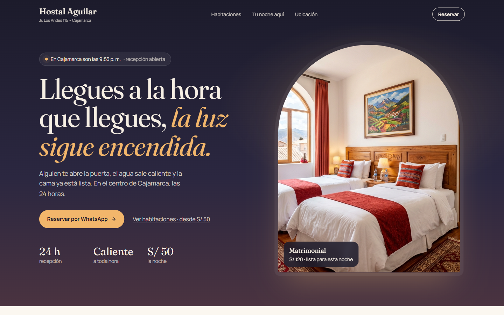
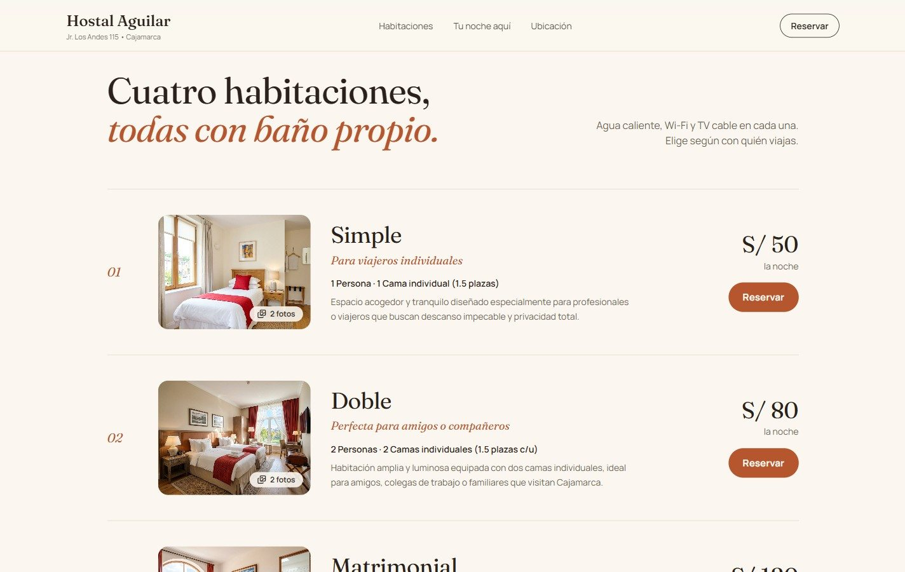
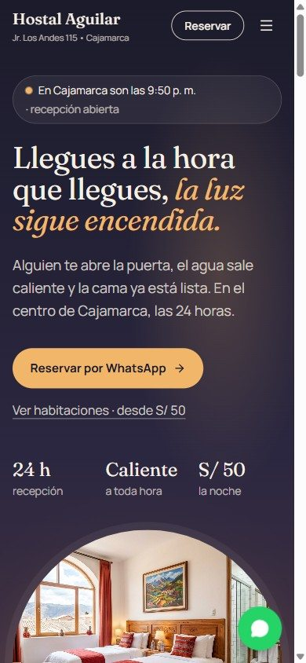
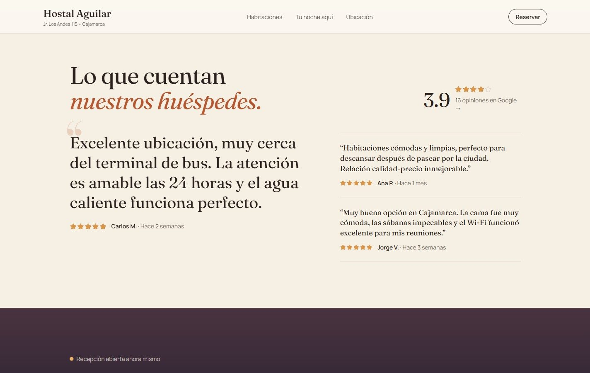

<p align="center">
  <a href="https://hostal-aguilar.pages.dev/">
    
  </a>
</p>

<h1 align="center">Hostal Aguilar</h1>

<p align="center">
  <b>Hospedaje con recepción 24 horas · Cajamarca, Perú</b><br>
  Web con habitaciones, reservas por WhatsApp y panel administrable
</p>

<p align="center">
  <a href="https://hostal-aguilar.pages.dev/"><b>🌐 Ver en vivo</b></a> ·
  <a href="#el-concepto">Concepto</a> ·
  <a href="#galería">Galería</a> ·
  <a href="#para-desarrolladores">Para desarrolladores</a>
</p>

<p align="center">
  
  
  
  
  
  
</p>

> **Llegues a la hora que llegues, la luz sigue encendida.** Alguien te abre la puerta, el agua sale caliente y la cama ya está lista.

## El reto

El Hostal Aguilar tenía una web generada con IA: plantilla azul corporativo, tarjetas iguales, rutas que solo funcionaban en desarrollo y un panel de administración con la contraseña escrita en el código. El trabajo fue **darle una identidad propia, rehacer el diseño completo y convertir el panel en uno real y seguro**, sin perder los datos del negocio.

## El concepto

**La luz encendida.** Mucha gente llega a Cajamarca de madrugada. Lo que un viajero busca a esa hora es una puerta que se abra, agua caliente y una cama. La web se construye alrededor de esa promesa:

- 🕯️ **El momento estrella:** el Hero muestra la **hora real de Cajamarca** ("son las 2:37 a. m. · recepción abierta") y su cielo cambia suavemente según el momento del día: madrugada, amanecer, día y atardecer.
- 🎨 Paleta de noche, ámbar y adobe cajamarquino en lugar del azul corporativo. Tipografía Fraunces + Manrope.
- El cierre de la página vuelve a la noche del inicio: *"¿Llegas esta noche? Escríbenos y te esperamos."*

## Qué incluye

- 🛏️ **Habitaciones** en formato de lista tipo carta, con galería de fotos y reserva por WhatsApp con fechas y total estimado.
- 🧭 **"Tu noche en el Hostal Aguilar"**: los servicios contados como un recorrido.
- 📍 **Ubicación** con mapa, "Cómo llegar" y "Copiar dirección para el taxi".
- ⭐ **Opiniones** en formato de revista, con la calificación real de Google.
- 🔐 **Panel de administración** (`/#admin`): precios, habitaciones, servicios y datos del hostal; los cambios se publican al instante para todos.
- 📒 **Libro de Reclamaciones**, términos y políticas.
- 🔗 Vista previa al compartir por WhatsApp y redes.

## Galería

<table>
  <tr>
    <td width="72%"></td>
    <td width="28%" rowspan="2"></td>
  </tr>
  <tr>
    <td></td>
  </tr>
</table>

## Seguridad

- El contenido vive en Supabase: **todos pueden leerlo, solo un administrador puede editarlo** (reglas RLS + lista de correos autorizados).
- El acceso al panel usa Supabase Auth: **la contraseña no está en el código** y el cambio de contraseña lo verifica el servidor.
- El registro de cuentas nuevas está desactivado.
- No hay claves secretas en el repositorio: la clave de Supabase incluida es la pública.

## Créditos

Diseño y desarrollo: **Frank Abanto** ([@FrankUsqAbant](https://github.com/FrankUsqAbant)). Proyecto demo presentado al cliente.

---

## Para desarrolladores

<details>
<summary><b>Instalación, estructura y despliegue</b></summary>

### Correr en local

```bash
npm install
cp .env.example .env.local   # URL y clave pública de Supabase, y la dirección del sitio
npm run dev                  # http://localhost:3000
```

| Comando | Qué hace |
|---|---|
| `npm run dev` | Servidor local |
| `npm test` | Pruebas (`src/utils/*.test.ts`) |
| `npm run lint` | Revisión de tipos (TypeScript) |
| `npm run build` | Versión para publicar en `dist/` |

### Estructura

```
src/
  components/            secciones de la web y modales (reserva, FAQ, legales, reclamos)
  components/admin/      panel /#admin
  data/hostalData.ts     datos por defecto (si Supabase no responde, la web usa estos)
  lib/supabase.ts        cliente de Supabase (clave pública)
  utils/hostalStore.ts   lectura/escritura del contenido y acceso de administrador
  utils/dayPhase.ts      hora de Cajamarca y momento del día del Hero
public/images/           fotos de las habitaciones
supabase/schema.sql      tablas, reglas RLS y datos iniciales (generado por scripts/build-seed-sql.ts)
referencias-diseno/      propuestas de Hero (no se publica)
docs/                    capturas de este README
```

### Base de datos (Supabase)

1. Crear un proyecto y pegar `supabase/schema.sql` en **SQL Editor → Run**. Antes, reemplazar `tu-correo@ejemplo.com` por el correo del administrador.
2. **Authentication → Users → Add user** con ese correo (marcar *Auto Confirm User*).
3. **Authentication → Sign In / Providers**: desactivar *Allow new users to sign up*.

La tabla `site_content` guarda tres bloques JSON (`hostal_info`, `rooms`, `services`): lectura pública y escritura solo para correos en `admins` (función `is_admin()`).

### Publicar (Cloudflare Pages)

```bash
VITE_SITE_URL=https://hostal-aguilar.pages.dev npm run build
npx wrangler pages deploy dist --project-name hostal-aguilar --branch main
```

`VITE_SITE_URL` se usa en las etiquetas de vista previa (`og:image`), que necesitan la dirección completa.

</details>
